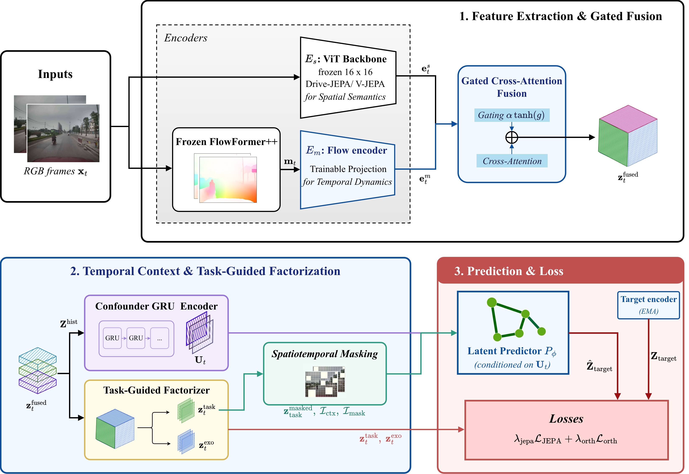

# ToMo-JEPA

Implementation of **"ToMo-JEPA: Motion-Aware Joint Embedding Predictive Architecture with Task-Guided Orthogonal Latent Factorization for Driving"**.

ToMo-JEPA is a motion-aware video JEPA for autonomous-driving world models. It:

1. **Injects explicit optical-flow features** into the latent space of a frozen pretrained video JEPA (Drive-JEPA / V-JEPA 2 ViT-L) through a **zero-initialized gate**, which preserves the pretrained representation at initialization.
2. **Factorizes the fused latent** with QR-derived orthogonal projectors into a predictor-feeding **task subspace** (shaped by the prediction objective) and an **exogenous subspace**.
3. Summarizes latent history with a lightweight **ConfounderGRU** that provides a temporal context vector `U_t` for the predictor.



## Installation

```bash
git clone https://github.com/ngocho31/ToMo-JEPA.git
cd ToMo-JEPA
pip install -r requirements.txt
```

External dependencies (not bundled) go under `third_party/` by default:

| Component | Default path | Override |
|---|---|---|
| [V-JEPA 2](https://github.com/facebookresearch/vjepa2) source | `third_party/vjepa2` | `VJEPA2_ROOT` |
| [FlowFormer++](https://github.com/XiaoyuShi97/FlowFormerPlusPlus) source | `third_party/flowformer` | `FLOWFORMER_ROOT` |
| Drive-JEPA ViT-L checkpoint | `checkpoints/vitl_merge_3dataset_e50.pt` | `VITL_CHECKPOINT_PATH` |
| FlowFormer++ checkpoint | `checkpoints/kitti.pth` | `FLOWFORMER_CHECKPOINT_PATH` |

## Data format

The dataset used in the paper is **private and not released**. Training and evaluation expect episodes in the following layout:

```text
data/
  episodes/<split>/<log_name>.npz
  images/<split>/<log_name>/<frame_token>.jpg
  manifest.jsonl
  dataset_info.json
```

`DATASET_ROOT` may point to the `data/` directory containing `episodes/`, `images/`, `manifest.jsonl`, and `dataset_info.json`.

Each `.npz` episode holds arrays that share the same leading frame dimension `N`:

| Key | Shape | Description |
|---|---|---|
| `timestamps_us` | `[N]` | Frame timestamps in microseconds |
| `image_paths` | `[N]` | Image paths relative to `<source>` |
| `can_bus` | `[N, 18]` | Retained vehicle-state vector |

Images and CAN-bus values at index `t` come from the same camera timestamp (downsampled to at most 10 Hz by default). The loader slides a window of `history_length` frames (default 16) with a given `stride` and returns a `FrameBatch` with `images: [B, T, 3, H, W]` (float32 in `[0, 1]`, default 256x256).

## Training

```bash
# single GPU
DATASET_ROOT=data python -m tomo_jepa.cli

# multi-GPU
DATASET_ROOT=data torchrun --nproc_per_node=4 -m tomo_jepa.cli
```

Common environment variables: `DATASET_ROOT`, `DATASET_SPLIT`, `BATCH_SIZE`, `NUM_WORKERS`, `EPOCHS`, `RUN_DIR`, `RESUME_CHECKPOINT`.

Ablations: `ABLATION_MOTION_BRANCH=1` (no motion branch), `ABLATION_FACTORIZER=1` (no orthogonal factorization), `ABLATION_CONFOUNDER=1` (no ConfounderGRU).

Only the trainable modules (motion encoder, fusion, factorizer, confounder, predictor) are checkpointed; frozen ViT encoders are not saved.

## Evaluation

```bash
python -m tomo_jepa.evaluation.eval_motion_ablation --help
python -m tomo_jepa.evaluation.eval_motion_weighted_masking --help
python -m tomo_jepa.evaluation.eval_ego_trajectory --help
```

## Citation

```bibtex
@inproceedings{ho2026tomojepa,
  title     = {ToMo-JEPA: Motion-Aware Joint Embedding Predictive Architecture with Task-Guided Orthogonal Latent Factorization for Driving},
  author    = {Ho, Ngoc P. and Nguyen, Phuong N. M. and Pham, Thanh N. C. and Nguyen, Nam H. and Nguyen, Khanh H. and Pham, Anh T. and Dang, Vinh Q. and Nguyen, Anh T. and Quan, Tho T.},
  year      = {2026}
}
```

## Acknowledgements

Built on [V-JEPA 2](https://github.com/facebookresearch/vjepa2), [Drive-JEPA](https://github.com/linhanwang/Drive-JEPA), and [FlowFormer++](https://github.com/XiaoyuShi97/FlowFormerPlusPlus). Please follow their licenses and terms.

## License

Released under the [MIT License](LICENSE).
